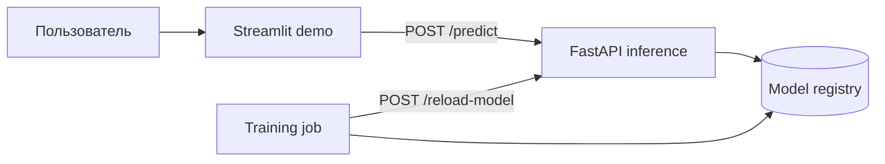

# Customer Churn

ML-сервис  для бинарной классификации отклика клиента на банковское предложение.

## Что это за проект

Проект реализует ML-сервис для предсказания вероятности оформления срочного депозита и состоит из трёх частей:

- `inference service`
  - сервис на `FastAPI`, который работает постоянно;
  - загружает текущую production-модель из локального реестра моделей;
  - принимает запросы на предсказание.
- `training service`
  - запускается по требованию как одноразовая задача;
  - обучает новую версию модели на данных;
  - проверяет метрики перед promotion;
  - публикует новую модель в реестр и уведомляет `inference` о перезагрузке.
- `demo service`
  - демонстратор на `Streamlit`;
  - отправляет форму с признаками клиента в FastAPI через HTTP;
  - показывает вероятность оформления депозита, итоговый ответ и версию модели.

Проект использует:

- `uv` для управления зависимостями;
- `Docker` и `Docker Compose` для запуска сервисов;
- общий preprocessing для `training` и `inference`;
- локальный файловый реестр моделей с aliases `latest` и `production`;
- `pytest`, `pytest-cov` и `Ruff` для проверки качества кода;
- GitHub Actions для CI.

## Архитектура

- `inference service`
  - сервис на `FastAPI`, работающий постоянно;
  - загружает текущую production-модель из локального реестра;
  - предоставляет endpoints `health`, `model-info`, `predict` и `reload-model`.
- `training service`
  - одноразовая задача, запускаемая по требованию;
  - загружает CSV-данные, обучает новую модель, считает метрики и продвигает модель, если она проходит валидацию.
- `model registry`
  - локальный файловый реестр моделей с версиями и aliases;
  - aliases: `latest`, `production`.
- `demo service`
  - интерфейс на Streamlit;
  - обращается к inference по адресу из переменной окружения `API_URL`.



## Установка через `uv`

1. Установите `uv`.
2. Создайте окружение и установите зависимости строго по lock-файлу:

```bash
uv sync --frozen
```

В Windows PowerShell активировать окружение можно командой:

```powershell
.\.venv\Scripts\Activate.ps1
```

Создайте `.env` на основе примера:

```powershell
Copy-Item .env.example .env
```

Основные переменные окружения: `RAW_DATA_PATH`, `MODEL_REGISTRY_PATH`, `INFERENCE_URL`, `API_URL`, `SUBSCRIPTION_THRESHOLD` и пороги promotion-модели.

## Как запускать

### Локальный запуск Inference

```bash
uv run python -m uvicorn src.inference.app:app --host 0.0.0.0 --port 8000
```

Swagger UI: <http://localhost:8000/docs>.

### Локальный запуск Streamlit

Сначала запустите inference, затем в другом терминале:

```bash
uv run streamlit run src/demo/app.py
```

Демонстратор будет доступен по адресу <http://localhost:8501>.

### Локальный запуск Training

```bash
uv run python -m src.training.run_training
```

Во время работы `training`:

- загружается CSV с данными;
- обучается модель `LGBMClassifier` в составе pipeline;
- считаются метрики `accuracy`, `precision`, `recall`, `f1`, `roc_auc`, `pr_auc`;
- новая модель сравнивается с порогами и текущей production-моделью;
- при успешной валидации создаётся новая версия, обновляются aliases `latest` и `production`;
- вызывается `POST /reload-model` у inference-сервиса.

Если inference недоступен, обучение и регистрация модели всё равно завершаются; в лог записывается предупреждение о невозможности перезагрузки модели.

### Запуск через Docker Compose

Запуск inference и Streamlit:

```bash
docker compose up --build
```

После запуска доступны:

- FastAPI: <http://localhost:8002>;
- Swagger UI: <http://localhost:8002/docs>;
- Streamlit: <http://localhost:8501>.

Запуск training как одноразовой задачи:

```bash
docker compose --profile training run --rm training
```

Inference и training используют общие volumes:

- `./model_registry:/app/model_registry`;
- `./data:/app/data`.

## Результаты

После запуска проекта доступны следующие результаты:

- `GET /health`
  - показывает, запущен ли inference и загружена ли модель.
- `GET /model-info`
  - возвращает имя текущей production-модели и её версию.
- `POST /predict`
  - возвращает вероятность оформления срочного депозита и итоговое предсказание.
- `POST /reload-model`
  - перезагружает production-модель из реестра.
- `training service`
  - создаёт новую версию модели;
  - записывает metrics и metadata в `model_registry`;
  - обновляет alias `production`, если модель прошла валидацию.

Пример результата `POST /predict`:

```json
{
  "subscription_probability": 0.0111,
  "prediction": "no",
  "model_version": "churn_model_20260404_161620"
}
```

## API Endpoints

- `GET /health`
  - состояние сервиса и доступность модели.
- `GET /model-info`
  - имя и версия текущей загруженной модели.
- `POST /predict`
  - возвращает вероятность оформления срочного депозита и результат `yes`/`no`.
- `POST /reload-model`
  - перезагружает текущую production-модель из реестра.

## Пример `POST /predict`

```bash
curl -X POST "http://localhost:8000/predict" \
  -H "Content-Type: application/json" \
  -d '{
    "age": 58,
    "job": "management",
    "marital": "married",
    "education": "tertiary",
    "default": "no",
    "balance": 2143,
    "housing": "yes",
    "loan": "no",
    "contact": "unknown",
    "day": 5,
    "month": "may",
    "duration": 261,
    "campaign": 1,
    "pdays": -1,
    "previous": 0,
    "poutcome": "unknown"
  }'
```

Пример ответа:

```json
{
  "subscription_probability": 0.0111,
  "prediction": "no",
  "model_version": "churn_model_20260404_161620"
}
```

## Версионирование и Promotion

Структура реестра моделей:

```text
model_registry/
├── versions/
│   └── <model_version>/
│       ├── model.joblib
│       ├── metadata.json
│       └── metrics.json
└── aliases/
    ├── production.json
    └── latest.json
```

Процесс promotion:

1. `training` создаёт имя новой версии модели.
2. Обученный pipeline сохраняется как `model.joblib`.
3. Metrics и metadata записываются в каталог версии.
4. Alias `latest` обновляется автоматически.
5. Если валидация пройдена, обновляется alias `production`.
6. Inference перезагружает новую production-модель через `/reload-model`.

## Тесты и качество кода

Запуск линтера:

```bash
uv run ruff check .
uv run ruff format --check .
```

Запуск тестов с coverage:

```bash
uv run pytest --cov --cov-report=term-missing
```

Минимальный порог coverage — 75%.

## CI/CD

CI настроен через GitHub Actions: при `push` и `pull request` в `main` запускаются установка по `uv.lock`, Ruff, pytest с coverage и сборка Docker-образов inference, training и demo.

CD пока не настроен: для автоматического развёртывания нужна отдельная цель, например сервер с Docker. Сборка образов в CI не является deployment.
